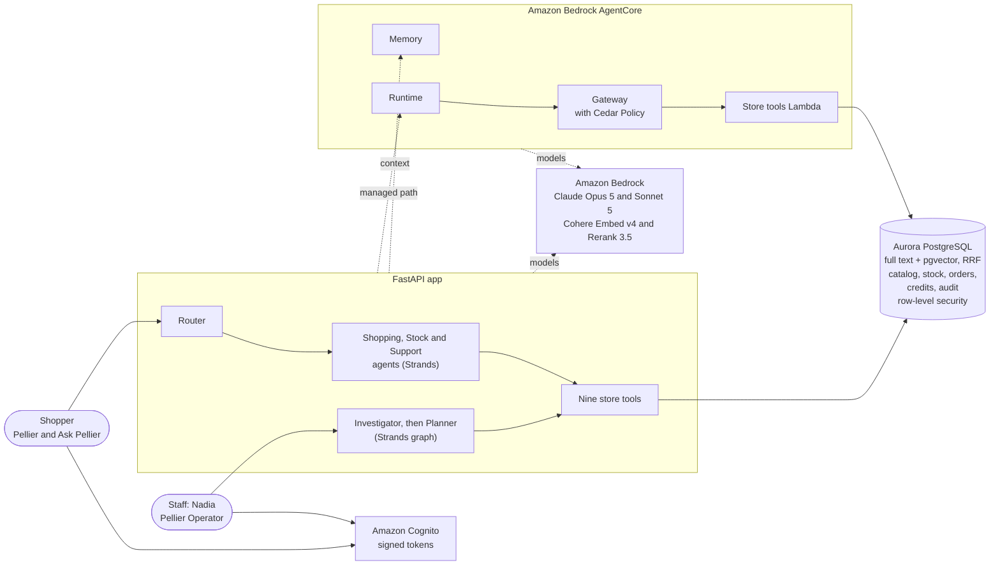

# Pellier: governed agentic AI search

The application and lab code for the AWS workshop *Build governed agentic AI search with Aurora, RDS, & Bedrock AgentCore* (DAT416).

[](LICENSE)
[](https://github.com/aws-samples/sample-pellier-agentic-search-apg/actions/workflows/quality.yml?query=branch%3Agoverned)
[](https://www.python.org/)
[](https://github.com/pgvector/pgvector)
[](https://aws.amazon.com/bedrock/agentcore/)
[](https://nodejs.org/)

> This is an educational sample for a workshop, not production code. See [Security and responsible use](#security-and-responsible-use).

## What Pellier is

Pellier is a small store invented for this workshop. Its assistant, Ask Pellier, answers shoppers from live data in Aurora PostgreSQL: the catalog, warehouse stock, orders and support tickets. Staff use the Operator (`/operator`), where agents investigate a case and propose a store credit, and a person approves anything that moves money. The workshop asks one question: how do you let an agent act on real data and prove what happened?

## The four labs

Each lab follows one customer and answers one question a store's leadership would ask. Task A is a supplied change you apply by command; Task B is code you build in a marked region. Each task ends with a check against Aurora and the deployed services.

| Lab | Leadership question | Apply (A) and build (B) | What proves it |
|---|---|---|---|
| 1. Retrieve, Anna | "Can we deliver relevant recommendations while preserving every customer requirement?" | A: the vector branch that ranks her eligible products by meaning. B: a search fallback that keeps her budget, stock and exclusions | A product searched with its own embedding comes back first, and every product returned meets her limits in Aurora |
| 2. Ground, Marco | "Can we rely on the assistant's answers when making commitments to customers?" | A: connect `check_stock` to the Stock agent, alone. B: the stock check's SQL, so a piece Pellier does not carry is never reported as sold out | The agent's counts match the warehouse rows in Aurora |
| 3. Deploy, Theo | "When we deploy the agent on AgentCore, how do we ensure every request carries the right identity and permissions?" | A: publish `get_tickets` on AgentCore Gateway and bind it to the signed-in caller. B: the row-ownership predicate, written while the agent deploys to AgentCore Runtime | His tickets come back and another customer's never do, a new session recalls his taste from AgentCore Memory, and the audit rows name the build that ran |
| 4. Govern, Jessica with Nadia (staff) | "Can the assistant act within approved limits, with a record of exactly what changed?" | A: a Cedar rule that caps a staff store credit at $100. B: the money role's privileges, so it writes only through the credit function | An approved credit of up to $100 is recorded once, even on retry; $100.01 is denied and leaves no row; the money role cannot write a credit directly |

## Architecture



- **Router and agents.** A deterministic Router, with no model call, sends each request to one of three Strands agents: Shopping and Support on Claude Opus 5, Stock on Claude Sonnet 5. `pellier/backend/services/intent_router.py`, `pellier/backend/agents/`
- **Store tools.** Nine tools, one implementation for the local agents and the Gateway Lambda: `search_products`, `browse_department`, `compare_products`, `check_stock`, `get_orders`, `get_return_policy`, `get_tickets`, `give_store_credit` and `ask_a_person`. `pellier/backend/services/store_tools.py`
- **Hybrid search.** The shopper's limits become SQL filters on a pgvector branch and a full-text branch. Reciprocal Rank Fusion (k = 60) merges them and Cohere Rerank 3.5 reorders the pool. Search covers the 1,000 photographed products of a 50,000-row catalog, through a filter applied before ranking and a partial HNSW index. A shopper's search records its ranks in a retrieval receipt, and Builder view shows them as "How it ranked". `pellier/backend/services/search_plan.py`
- **Managed path.** AgentCore Runtime runs the same Router and agents, with their tools behind AgentCore Gateway. AgentCore Policy evaluates Cedar before the Lambda runs, so a denied call never executes. `pellier/backend/agentcore_runtime.py`, `scripts/deploy/gateway_tool_schemas.py`, `policies/`
- **Identity and ownership.** Amazon Cognito signs in shoppers and staff. Runtime verifies the access token itself, and a customer-scoped read uses the customer in the signed token, never one the model names; Cedar checks it again at the Gateway. `get_orders` and `get_tickets` run as the `pellier_agent` role under row-level security, so Aurora returns only that customer's rows. `pellier/backend/services/runtime_identity.py`, `workshop/lab-3-row-ownership.sql`
- **Human approval.** In the Operator, an Investigator and a Planner (a Strands graph) read the case and propose one credit. `give_store_credit` writes only for a review a person approved with the same arguments, once per review key, as `pellier_credit_writer`, a role that may only execute the credit function. `pellier/backend/services/operator_graph.py`, `workshop/lab-4-credit-writer.sql`
- **Memory.** AgentCore Memory keeps conversation events and the preferences extracted from them. A remembered preference can guide a pick; prices and stock always come from Aurora. `pellier/backend/services/agentcore_memory.py`
- **Evidence.** Every tool call that runs writes a `pellier.tool_audit` row with its turn's id; a denied call writes none. App and AgentCore spans reach CloudWatch tagged with `pellier.turn_id`. `pellier/backend/services/evidence_spans.py`, `scripts/observability_check.py`

## Run it

### In the workshop

At an AWS event, Workshop Studio gives you an AWS account with Aurora PostgreSQL, Amazon Cognito and the AgentCore resources already provisioned, a browser-based Code Editor with this repository, and the lab guide. The guide is the source of truth for every step and check. In Code Editor, start with [START_HERE.md](START_HERE.md); [Pellier.code-workspace](Pellier.code-workspace) opens one folder per lab, each with a short README, links to its task files and a solution folder.

### Locally

Prerequisites:

- Python 3.14 and Node.js 24. CI, the workshop box, AgentCore Runtime and the Lambdas all run Python 3.14.
- PostgreSQL 18 or later with the `vector` (pgvector) and `pg_trgm` extensions, a user that can create extensions and roles, and `psql`. The workshop uses Aurora PostgreSQL.
- AWS credentials with Amazon Bedrock access to Claude Opus 5, Claude Sonnet 5, Cohere Embed v4 and Cohere Rerank 3.5.

From the repository root:

```bash
# 1. Backend environment
cd pellier/backend
python3 -m venv .venv
./.venv/bin/python -m pip install --require-hashes -r requirements.lock
cp .env.example .env    # set DB_* (or DATABASE_URL) and AWS_REGION
cd ../..

# 2. Into an existing, empty database: schema, the 50,000-product catalog
#    (from its committed embeddings) and the seed data
DB_HOST=localhost DB_PORT=5432 DB_NAME=pellier DB_USER=postgres DB_PASSWORD=... \
  PYTHON="$PWD/pellier/backend/.venv/bin/python" \
  bash scripts/setup/database-setup.sh

# 3. API on 127.0.0.1:8003 and the app on http://127.0.0.1:5173, with hot reload
cd pellier/frontend
npm ci
npm run dev
```

`npm run start:prod` instead builds the frontend and serves the app and API from FastAPI on port 8000.

Locally the agents run in process. Ask Pellier works signed out, and AgentCore Memory falls back to a process-local store when `AGENTCORE_MEMORY_ID` is empty. Shopper sign-in and the Operator need the Cognito user pool and demo users the workshop deployment creates (`COGNITO_*` in `.env`).

The code is in the labs' starting state: some marked regions are incomplete on purpose, and `solutions/` holds reference versions.

To deploy the managed path to your own account, `scripts/provision_agentcore_end_to_end.py` deploys the store tools Lambda and the AgentCore Runtime, Memory, Gateway and Policy resources with the pinned AgentCore CLI (`@aws/agentcore@0.29.0`). It expects an existing Aurora cluster and Cognito user pool, which the Workshop Studio templates create; those templates are not in this repository.

## Take it home

`takeaway/governed-postgres-agent` packages the four contracts the labs build (filter, then rank; bounded facts; ownership; write once) as an Agent Skill for reviewing an agent the way a DBA would: questions for the application team, a checklist per contract, templates from this source, and the SQL that proves each contract holds. To use it in Claude Code:

```bash
mkdir -p ~/.claude/skills
cp -r takeaway/governed-postgres-agent ~/.claude/skills/
```

Then run `/governed-postgres-agent review <path>` on your team's agent code. Its [README](takeaway/governed-postgres-agent/README.md) covers other agents and a first run against Pellier.

## Repository layout

| Path | Contents |
|---|---|
| `pellier/backend/` | FastAPI app: the Router, agents, store tools, routes and backend tests |
| `pellier/frontend/` | React and TypeScript app: the storefront, Ask Pellier and the Operator |
| `skills/` | Five runtime skills: instructions the agents load, not code |
| `policies/` | The Cedar rule Lab 4 applies |
| `labs/` | The Code Editor lab groups: each lab's README, links to its task files, and a solution folder |
| `workshop/` | The SQL files labs build or run, and a copy of each marked region as shipped |
| `solutions/` | Reference solutions for the lab tasks |
| `takeaway/` | `governed-postgres-agent`: the four contracts as an Agent Skill |
| `scripts/` | Database setup and migrations, catalog seeding, AgentCore deployment and lab checks |
| `data/` | The 50,000-product catalog and its cached Cohere Embed v4 vectors |
| `docs/` | Workshop design notes: the story arc, transport and AgentCore readiness |
| `tests/` | Deployment helpers for end-to-end runs and a performance smoke test |

## Tests

The [governed-quality workflow](.github/workflows/quality.yml) runs the backend, frontend and shell-script checks on every push to `governed`. The main ones, from the repository root:

```bash
(cd pellier/backend && ./.venv/bin/python -m pytest -q)
(cd pellier/frontend && npm test -- --run && npm run type-check && npm run lint && npm run build)
```

These checks run without AWS. Runtime, Gateway, Cedar and Lambda behavior is proven only in a provisioned account.

## Security and responsible use

This is an educational sample. Review it carefully before you use any part of it in production.

- **Synthetic data.** Products, prices, reviews, availability, customers and orders are synthetic data built for this workshop. Nothing here charges a card.
- **Demo accounts.** Choosing a shopper in Ask Pellier signs in one of four demo shoppers (Anna, Marco, Theo and Jessica) with a real Cognito sign-in that the server performs. It is a workshop convenience, not a production pattern. Staff accounts are never offered; Nadia signs in to the Operator with her password.
- **Imagery.** AI-generated imagery is for illustrative purposes only.
- **Reporting a security issue.** If you discover a potential security issue in this project, notify AWS Security through the [vulnerability reporting page](https://aws.amazon.com/security/vulnerability-reporting/). Do not create a public GitHub issue.

## License

This project is licensed under the MIT License. See [LICENSE](LICENSE), and [NOTICE](NOTICE) for the attribution requested when you reuse it.
