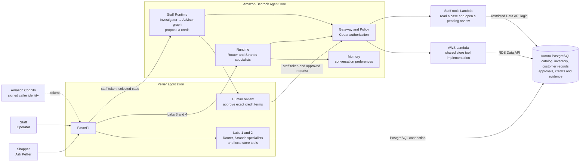

<div align="center">


# Pellier: governed agentic AI search

**Build a retail assistant grounded in PostgreSQL facts, with caller-bound access, human approval for store credits, and evidence you can inspect.**

The application and lab code for the AWS re:Invent 2026 workshop<br>
**DAT416-R: Build governed agentic AI search with Aurora, RDS, & Bedrock AgentCore**<br>
Level 400 · Four connected labs · 120 minutes

[](https://github.com/aws-samples/sample-pellier-agentic-search-apg/actions/workflows/quality.yml?query=branch%3Agoverned)
[](LICENSE)
[](#the-four-labs)

[The four labs](#the-four-labs)&nbsp;&nbsp;|&nbsp;&nbsp;[Architecture](#architecture)&nbsp;&nbsp;|&nbsp;&nbsp;[Run it](#run-it)&nbsp;&nbsp;|&nbsp;&nbsp;[Take it home](#take-it-home)&nbsp;&nbsp;|&nbsp;&nbsp;[Tests](#tests)

</div>

> [!IMPORTANT]
> Use **`governed`**, the default branch, for this workshop and the current application. The [`main` branch](https://github.com/aws-samples/sample-pellier-agentic-search-apg/tree/main) contains a separate, older application for a one-hour Builders' Session.

## What Pellier is

Pellier is a fictional retail store built to explore how agents can use business data under explicit controls. **Ask Pellier** answers shoppers from the catalog, warehouse inventory, orders and support tickets in Aurora PostgreSQL. In the **Operator**, staff review an agent's investigation and approve or reject a proposed store credit.

The application combines the Strands Agents SDK, Amazon Bedrock models, and Amazon Bedrock AgentCore Runtime, Memory, Gateway and Policy. PostgreSQL supplies full-text search, pgvector, row-level security and the transaction controls behind each credit. SQL records and service traces let participants inspect what happened independently of the assistant's answer.

This is an educational sample with synthetic business data. **The checked-in lab files deliberately contain the faults participants repair.** To reuse a completed pattern, start with [the reference solutions](solutions/README.md) and review [Security and responsible use](#security-and-responsible-use).

## The four labs

Each lab follows one customer and answers one question a store's leadership would ask. In **Task A**, you apply a supplied change and inspect it. In **Task B**, you build a fix in a marked region. Terminal checks examine the relevant code, database records or deployed services. Labs 1 and 2 run the agents in process. Lab 3 carries the changes into AgentCore, and Lab 4 governs the credit workflow.

| Lab | Leadership question | Apply (A) and build (B) | What proves it |
|---|---|---|---|
| 1. Retrieve, Anna | "Can search match intent and keep every shopper requirement?" | A: the vector search that ranks her eligible products by meaning. B: a search fallback that keeps her budget, stock and exclusions | A product searched with its own embedding comes back first, and every product returned meets her requirements in Aurora |
| 2. Ground, Marco | "Can every stock answer be backed by a warehouse record?" | A: connect `check_stock` to the Stock agent, alone. B: the stock check's SQL, so a piece Pellier does not carry is never reported as sold out | The agent's counts match the warehouse rows in Aurora |
| 3. Deploy, Theo | "Can each shopper access only their own records on AgentCore?" | A: publish `get_tickets` on AgentCore Gateway and bind it to the signed-in caller. B: the row-ownership predicate, written while the agent deploys to AgentCore Runtime | His tickets come back and another customer's never do, a new session recalls his taste from AgentCore Memory, and the audit rows name the build that ran |
| 4. Govern, Jessica with Nadia (staff) | "Can an approved credit stay within its limit and be paid only once?" | A: a Cedar rule that caps a staff store credit at $100. B: the credit-writer role's privileges, so it writes only through the credit function | A retry leaves exactly one intended credit. A $100.01 attempt has a Gateway denial and no matching execution or credit row. Direct writes by the credit-writer role fail. |

## Architecture



The diagram shows application and database paths. Amazon Bedrock supplies Claude Opus 5.5 for the Catalog and Support agents, Claude Sonnet 5.5 for the Stock agent and Operator graph, Cohere Embed v4 for embeddings, and Cohere Rerank 3.5 for reranking.

### Retrieval and factual answers

A deterministic [Router](pellier/backend/services/intent_router.py) selects the Catalog, Stock or Support specialist without making a model call. Each specialist has a bounded tool set. The [shared implementation](pellier/backend/services/store_tools.py) provides nine tools for the local agents and Gateway Lambda, including search, stock, customer reads, a human handoff and the staff credit operation. Shopper agents cannot invoke the credit writer.

Hybrid retrieval applies shopper requirements to full-text and pgvector candidates, combines their ranks with reciprocal rank fusion (`k = 60`), and reranks the resulting pool with Cohere Rerank. [The search plan](pellier/backend/services/search_plan.py) separates requirements from preferences. Lab 1 repairs the vector ranking and the retry that loses those requirements.

**Catalog size and search scope are different.** All 50,000 catalog products have embeddings. The Storefront and shopper tools use the 1,000 products with images, with the same visibility predicate in both retrieval paths and a partial HNSW index for that subset. The optional [index experiment](workshop/lab-1-index.sql) uses the larger corpus to compare exact and approximate retrieval. The required lab is not a benchmark of shopper search across all 50,000 products.

Inventory answers come from the product's warehouse rows. The completed stock tool distinguishes a product the store does not carry, recorded zero stock, and a catalog product whose inventory records are missing. Retrieval receipts preserve the search plan and ranks for inspection in SQL and the Builder view.

### Identity, approval and memory

- **Caller identity.** [Runtime verifies the Cognito token](pellier/backend/services/runtime_identity.py) and binds customer-scoped tools to that caller. Gateway Policy evaluates Cedar before invoking Lambda. The completed Lab 3 path combines owner checks at Gateway with PostgreSQL row-level security for orders and tickets.
- **Database access.** Store tools use the restricted `pellier_store_tools` login. Customer reads switch to `pellier_agent` within a transaction. The staff graph uses a separate `pellier_operator_tools` login, and row-level security limits its order and ticket reads to the selected case's customer. Both read roles are non-owners with `NOBYPASSRLS`. The staff role can open a pending review but cannot approve it or become the credit writer. The completed credit-writer privileges allow execution of the credit function without direct writes to the credit table. The [schema migration](scripts/migrations/001_schema.sql) defines the roles, grants and constraints.
- **Human approval.** The [Operator graph](pellier/backend/services/operator_graph.py) investigates a case and proposes a credit. [Governed execution](pellier/backend/services/governed_execution.py) requires an approved review with matching terms before calling Gateway. Cedar supplies the workshop's $100 limit. Unique approval and idempotency keys keep a retried request from creating another credit.
- **Memory.** [AgentCore Memory](pellier/backend/services/agentcore_memory.py) stores conversation events and extracted preferences. [Runtime reads preferences](pellier/backend/services/runtime_memory.py) for the verified customer. Preferences can inform recommendations, but identity and permissions come from verified credentials and enforcement code. Product, stock and order facts come from PostgreSQL.

### Evidence and its limits

The managed credit path commits the new credit and its successful `tool_audit` receipt in one database transaction. A successful replay returns the existing credit without adding another success receipt. Staff proposals and their audit receipts also commit together. Store read receipts are best effort, so a missing audit row alone does not establish that a call was denied.

[The credit reconstruction check](scripts/follow_credit.py) correlates approval and credit rows with tool receipts, Gateway request identifiers, build fingerprints and service traces. A request-specific Gateway denial supports non-execution. An ALLOW decision or a missing Lambda span alone does not establish execution. CloudWatch delivery is asynchronous, and the workshop's pgAudit logs provide additional database evidence subject to their correlation limits.

### Aurora and RDS for PostgreSQL

The supplied deployment uses **Aurora PostgreSQL Serverless v2**. Gateway Lambda reaches it through the [RDS Data API for Aurora](https://docs.aws.amazon.com/AmazonRDS/latest/AuroraUserGuide/data-api.html). The SQL patterns for full-text search, pgvector, fusion, row-level security and transactional credits also apply to RDS for PostgreSQL, subject to its [supported extension versions](https://docs.aws.amazon.com/AmazonRDS/latest/UserGuide/PostgreSQL.Concepts.General.FeatureSupport.Extensions.html).

RDS for PostgreSQL requires adapting the deployment and database transport to a PostgreSQL connection with appropriate TLS, credentials and network access. The provided CloudFormation templates and managed Data API path deploy Aurora.

## Run it

### In the workshop

At an AWS event, Workshop Studio provides a temporary AWS account and a prepared environment with Aurora PostgreSQL, Amazon Cognito, AgentCore resources and a browser-based Code Editor. Participants update the managed deployment in Lab 3. Follow the event's lab guide for the exact steps and checks. [Pellier.code-workspace](Pellier.code-workspace) opens one folder per lab, with links to the task files and reference solutions.

### Locally

Prerequisites:

- Python 3.14 and Node.js 24. CI, the workshop box, AgentCore Runtime and the Lambdas all run Python 3.14.
- PostgreSQL 18 with the `vector` (pgvector) and `pg_trgm` extensions, `psql`, and a superuser for setup. The schema creates extensions and database roles. The Aurora deployment uses the cluster's master user for setup.
- AWS credentials with Amazon Bedrock access to Claude Opus 5.5, Claude Sonnet 5.5, Cohere Embed v4 and Cohere Rerank 3.5.

Clone the default branch without its history:

```bash
git clone --depth 1 --branch governed https://github.com/aws-samples/sample-pellier-agentic-search-apg.git
cd sample-pellier-agentic-search-apg
```

From the repository root:

```bash
# 1. Backend environment
cd pellier/backend
python3 -m venv .venv
./.venv/bin/python -m pip install --require-hashes -r requirements.lock
cp .env.example .env    # set DB_* (or DATABASE_URL) and AWS_REGION
cd ../..

# 2. Into an existing, empty database: schema, the 50,000-product catalog
#    (from its committed embeddings) and the seed data
DB_HOST=localhost DB_PORT=5432 DB_NAME=pellier DB_USER=postgres DB_PASSWORD=... \
  PYTHON="$PWD/pellier/backend/.venv/bin/python" \
  bash scripts/setup/database-setup.sh

# 3. API on 127.0.0.1:8003 and the app on http://127.0.0.1:5173, with hot reload
cd pellier/frontend
npm ci
npm run dev
```

`npm run start:prod` instead builds the frontend and serves the app and API from FastAPI on port 8000.

Locally the agents run in process. Ask Pellier works signed out, and AgentCore Memory falls back to a process-local store when `AGENTCORE_MEMORY_ID` is empty. Shopper sign-in and the Operator need the Cognito user pool and demo users the workshop deployment creates (`COGNITO_*` in `.env`).

### In your AWS account

Follow [Run Pellier in your own account](docs/run-in-your-own-account.md) for deployment, prerequisites, readiness checks and teardown. `deploy/own-account/deploy.py` uses the same four CloudFormation templates as Workshop Studio. On the host, `scripts/provision_agentcore_end_to_end.py` provisions the store and Operator tool Lambdas and AgentCore resources with the pinned CLI (`@aws/agentcore@0.29.0`). Follow the guide's full teardown procedure to remove both the stack and the resources created outside CloudFormation.

### What it costs

The own-account guide records the following example estimates from a test event using us-east-1 list prices on **6 November 2026**, before tax and Free Tier credits. These are dated examples, not a current price quote or a spending limit.

| What | Cost |
|---|---|
| Hourly infrastructure under the recorded event's assumptions | $0.52 an hour, about $379 a month |
| Incremental usage for one scripted pass through the required requests | $0.51 to $0.52 |
| Deployment, a two-hour session and teardown | about $2.55, before extra requests or the coach |

Actual costs depend on Region, capacity, usage, session duration and pricing agreements. The recorded Aurora cluster remained active during idle hours, so its estimate includes that capacity. Additional requests and optional Claude Code coaching add usage. Local execution still incurs Bedrock charges and any costs of the database or host you provide. See [What you get and what it costs](docs/run-in-your-own-account.md#1-what-you-get-and-what-it-costs) for the measurements, assumptions, pricing links and cost controls.

## Take it home

`takeaway/governed-postgres-agent` packages the four contracts the labs build as a reusable Agent Skill. It includes review questions, checklists, source templates and SQL checks for filtering before ranking, grounding answers in records, enforcing ownership and writing an approved credit once. To use it in Claude Code:

```bash
mkdir -p ~/.claude/skills
cp -r takeaway/governed-postgres-agent ~/.claude/skills/
```

Then run `/governed-postgres-agent review <path>` on your team's agent code. Its [README](takeaway/governed-postgres-agent/README.md) covers other agents and a first run against Pellier.

To reuse the code itself, start from `solutions/`, not the lab files: at HEAD each lab file still holds the fault its lab repairs. [`solutions/README.md`](solutions/README.md) maps each finished file to the file it replaces, and `CLAUDE.md` (also read as `AGENTS.md`) lists where each contract is enforced.

## Repository layout

| Path | Contents |
|---|---|
| `pellier/backend/` | FastAPI app: the Router, agents, store tools, routes and backend tests |
| `pellier/frontend/` | React and TypeScript app: the storefront, Ask Pellier and the Operator |
| `skills/` | Five runtime skills: instructions the agents load, not code |
| `policies/` | The Cedar rule Lab 4 applies |
| `labs/` | The Code Editor lab groups: each lab's README, links to its task files, and a solution folder |
| `workshop/` | The SQL files labs build or run, and a copy of each marked region as shipped |
| `solutions/` | Reference solutions for the lab tasks |
| `takeaway/` | `governed-postgres-agent`: the four contracts as an Agent Skill |
| `scripts/` | Database setup and migrations, catalog seeding, AgentCore deployment and lab checks |
| `data/` | The 50,000-product catalog and its cached Cohere Embed v4 vectors |
| `deploy/` | `deploy/own-account/`: the deployer and the four CloudFormation templates Workshop Studio also uses |
| `docs/` | Workshop design notes (the story arc, transport, AgentCore readiness), the own-account guide and its evidence records |
| `tests/` | Deployment helpers for end-to-end runs and a performance smoke test |

## Tests

The [governed-quality workflow](.github/workflows/quality.yml) runs the backend, frontend, browser and shell-script checks on every push to `governed`. The browser tests answer every API call with an in-test stand-in, so they need no AWS. The main checks, from the repository root:

```bash
(cd pellier/backend && ./.venv/bin/python -m pytest -q)
(cd pellier/frontend && npm test -- --run && npm run type-check && npm run lint && npm run build)
```

These checks run without AWS. The tests that need a database start a throwaway PostgreSQL 18 cluster with pgvector from the binaries on `PATH` or in `PG_BIN` and run the real setup scripts against it; without one they skip, and the workflow's `backend-postgres` job installs one and sets `PELLIER_REQUIRE_POSTGRES=1` so they fail there instead. Runtime, Gateway, Cedar and Lambda behavior is proven only in a provisioned account.

The optional [DuckDB example](scripts/duckdb_federation.py) joins live warehouse stock to a training forecast in Parquet. Run its `prepare`, `query`, `check` and `cleanup` commands on the workshop host after the required labs. It creates a separate inventory-only PostgreSQL login and leaves the application's data and agent tools unchanged. The [SQL](workshop/duckdb-inventory.sql) keeps the forecast separate from available stock.

Its integration tests use an isolated local PostgreSQL cluster and install the optional dependencies through `uv`; they are separate from the backend suite:

```bash
uv run --no-project --with duckdb==2.0.0 --with 'psycopg[binary]==3.3.4' --with pytest==9.1.1 \
  python -m pytest -q optional-tests/test_duckdb_federation.py
```

## Security and responsible use

This is an educational sample. Review it carefully before you use any part of it in production.

- **Synthetic data.** Products, prices, reviews, availability, customers and orders are synthetic data built for this workshop. Nothing here charges a card.
- **Demo accounts.** Choosing a shopper in Ask Pellier signs in one of four demo shoppers (Anna, Marco, Theo and Jessica) with a real Cognito sign-in that the server performs. It is a workshop convenience, not a production pattern. Staff accounts are never offered; Nadia signs in to the Operator with her password.
- **Imagery.** AI-generated imagery is for illustrative purposes only.
- **Reporting a security issue.** If you discover a potential security issue in this project, notify AWS Security through the [vulnerability reporting page](https://aws.amazon.com/security/vulnerability-reporting/). Do not create a public GitHub issue.

## Contributing

Contributions follow [CONTRIBUTING.md](CONTRIBUTING.md). This project has adopted the [Amazon Open Source Code of Conduct](CODE_OF_CONDUCT.md).

## License

This project is licensed under the MIT License. See [LICENSE](LICENSE), and [NOTICE](NOTICE) for the attribution requested when you reuse it.
